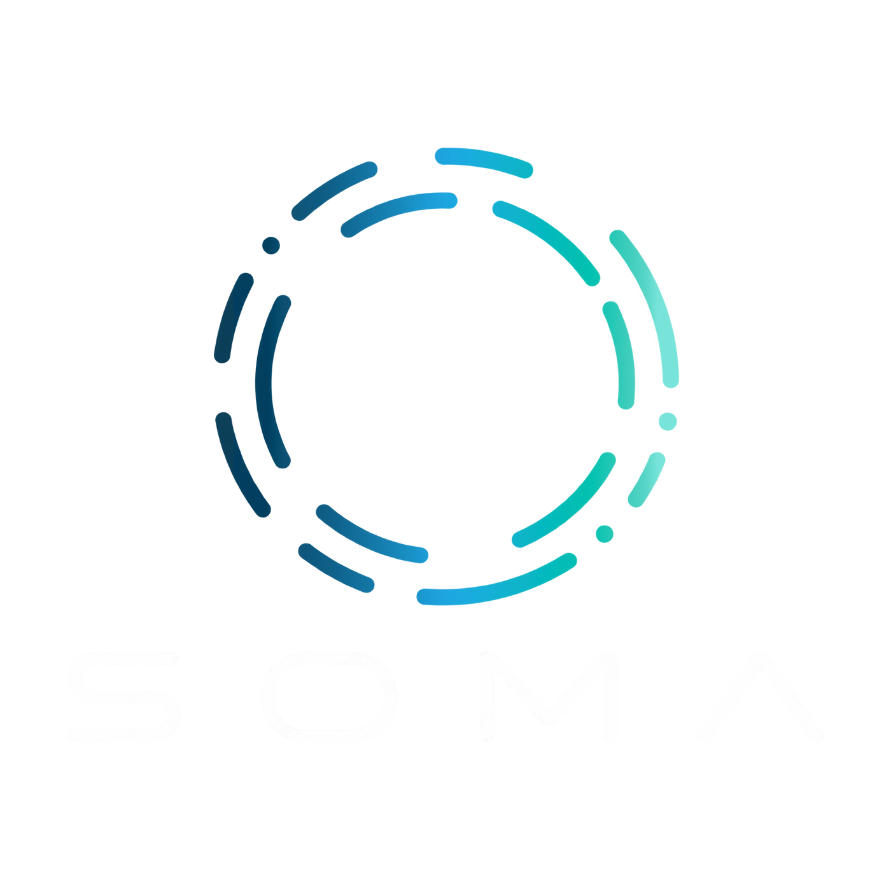

# SOMA Website

<p align="center">
  
</p>

<p align="center">
  <strong>Complex work. A clear plan.</strong><br />
</p>

<p align="center">
  <a href="#features">Features</a> &middot;
  <a href="#live-site">Live Site</a> &middot;
  <a href="#quick-start">Quick Start</a> &middot;
  <a href="#deployment">Deployment</a> &middot;
  <a href="#source-map">Source Map</a> &middot;
  <a href="#project-reference">Project Reference</a>
</p>

---

## Live Site

**[fedende51.github.io/soma-lp](https://fedende51.github.io/soma-lp/)** — public, published from `main` by GitHub Pages.

A password-protected preview is also hosted at [renderpopstudio.com/soma](https://www.renderpopstudio.com/soma); contact the project owner for its access password.

## Overview

This repository contains the company and product presentation website. It explains Scheduler's production-planning workflow through English and Japanese copy, a responsive homepage, an animated precision-ring visual, and an inline launch film.

The product sequences are illustrative. The website introduces Scheduler; it does not run a scheduling application or connect to customer production systems. Demo requests prepare an email, with appointments confirmed by a human reply.

## Features

- **English and Japanese.** Switch languages in the page header; the preference is retained locally.
- **Separate About page.** The company story, AI-agentic operating model, founders, mission and vision, Nippo K.K., company details and company FAQ are available in English and Japanese. Outstanding company facts are tracked in `design-assets/company-profile.json`.
- **Responsive presentation.** Phone and wider layouts use tailored headlines, imagery, and spacing.
- **Light and dark themes.** The selected theme is saved locally, with reduced-motion handling for transitions.
- **Animated brand and 3D artwork.** Original SOMA logo motion, a WebGL precision ring, poster assets, and scroll entrances support the product story.
- **Inline launch film.** Landscape and portrait compositions include seeking, sound, captions, fullscreen, keyboard controls, and native playback fallback.
- **Demo requests.** Choose a weekday and Japan time, prepare an email, or use the copyable fallback. The site does not automatically send or reserve an appointment.
- **Static deployment.** Browser assets are self-hosted. The optional password-screen source is maintained separately from the static site.

## Quick Start

Run from the repository root, with Node.js and npm installed:

```powershell
npm run dev
```

Open **http://127.0.0.1:4173**. The local server uses Node's built-in modules and serves the existing `dist/` files.

For the optional build, media, and validation tools, install the declared dependencies:

```powershell
npm install
```

## Deployment

Every push to `main` publishes the site. [`.github/workflows/deploy.yml`](.github/workflows/deploy.yml) uploads `dist/` exactly as committed to GitHub Pages; there is no build step, so what you see on the local server is what goes live. A deploy can also be started by hand from the repository's **Actions** tab (**Deploy to GitHub Pages → Run workflow**).

The site is served from the `/soma-lp/` subpath, so keep links and asset references in `dist/` relative (`assets/logo.png`, not `/assets/logo.png`).

`dist/` is plain static files and can be copied to any other static host. The optional PHP password screen used for the RenderPop Studio preview is described in [hosting/php/README.md](hosting/php/README.md); it is not used on GitHub Pages, and its private configuration is not part of this repository.

## Source Map

| Path | Purpose |
| --- | --- |
| `dist/` | Editable website source, self-hosted assets, captions, and final films |
| `visuals/` | Source for the precision-ring renderer and supporting visual code |
| `scripts/` | Local server, asset preparation, packaging, and validation workflows |
| `design-assets/` | Brand references and original visual inputs |
| `video/` | Launch-film composition, rendering, and audio workflow |
| `scheduler-launch/` | Additional launch-film source and its own workflow notes |
| `hosting/php/` | Optional password-screen source and integration instructions |
| `.github/workflows/deploy.yml` | Publishes `dist/` to GitHub Pages on every push to `main` |
| `DESIGN.md`, `MOTION.md`, `ASSETS.md` | Design direction, motion behavior, and asset provenance |

The primary branch is `main`. `dist/` contains maintained source and required browser assets; retain it in the repository. Third-party design-reference clones and local deployment artifacts are not site source.

## Maintainer Workflows

The package defines these commands:

```powershell
npm run ring:build
npm run check
```

`ring:build` rebuilds the bundled ring renderer and worker from `visuals/`. `check` validates local asset references, captions, and encoded film metadata; its current FFprobe path targets the Windows Remotion dependency.

The browser QA and poster-render scripts currently reference a local Codex Playwright installation and a Windows Chrome path. Adjust those machine paths before running them on another computer. Film rendering also needs the documented FFmpeg, Chrome, and audio inputs; see the preserved project reference below. These are workflow commands, not a claim that checks passed for the current checkout.

### Protected previews and delivery

Protected-preview checks and PHP ZIP packaging read `SOMA_PREVIEW_PASSWORD` from the environment. Supply it locally before running those workflows:

```powershell
$env:SOMA_PREVIEW_PASSWORD = '<preview password supplied by the owner>'
```

Clear it after use with `Remove-Item Env:SOMA_PREVIEW_PASSWORD`. Password values, `config.php`, FTP profiles, runtime state and generated delivery packages stay outside Git.

`scripts/deploy-renderpop.py` publishes a locally prepared PHP delivery to the RenderPop Studio preview (separate from the GitHub Pages site) over verified FTPS using the existing RenderPop Studio FileZilla entry. It stages and checks every website file before activation, preserves the host's password configuration and runtime, and retains a rollback copy outside the public folder. Hosting credentials are read from the local profile and are not included in this repository.

## Assets and Credits

See [ASSETS.md](ASSETS.md) for artwork and media provenance. Preserve the font, Three.js, GSAP, icon, and music notices supplied with the assets. The music source and working mixes are local production inputs; their use remains subject to their recorded license. The SOMA name and original logo retain their established branding.

## Project Reference

<details>
<summary>Detailed behavior, technical notes, and existing project documentation</summary>

# SOMA — Complex work. A clear plan.

Company/product site based on `../Arch/scheduler_brd.md`. English/Japanese, a white product presentation with the full logo gradient and original cropped wordmark with a counter-rotating logo entrance, a 32-second continuous-motion launch film, and email-based demo requests.

## Run

```powershell
npm install
npm run dev
```

Open http://127.0.0.1:4173. Deploy `dist/` as a static site. All browser assets—including Manrope and GSAP—are self-hosted. No application server, database, analytics, or external font service is required. Language preference is saved in browser local storage.

## Edit

- `dist/index.html`: English copy, product overview, booking dialog and inline film player.
- `dist/styles.css`: responsive visual system and tokens.
- `dist/app.js`: Japanese copy, language and booking.
- `dist/player.js`: inline film controls, captions, seeking, sound, fullscreen and native fallback.
- `dist/motion.js`: GSAP hero and one-time scroll entrances; reduced-motion handling.
- `dist/film/`: the new deterministic film, driven by `window.seek(seconds)`.
- `DESIGN.md`, `MOTION.md`, `DESIGN-REVIEW.md`: direction, choreography and ranked audit.

The website introduces Scheduler; it contains no interactive scheduling sample. No customer production records, adoption metrics, testimonials, or live integrations are claimed. P1 planner-maintained scheduling is distinguished from future tracking and collaboration.

## Booking

Share `/?demo=1#book-demo`. The dialog collects a weekday and Japan time (UTC+9), then prepares an email to **paolino.luis@gmail.com**. Nothing is sent or reserved automatically. A copyable fallback is provided. A human reply confirms the appointment.

## Film

A 32-second launch film in two compositions: **1920×1080** for larger screens and **1080×1350 (4:5)** for phones, both 60 fps H.264/yuv420p/BT.709 with stereo AAC. The phone composition stacks and enlarges the story; it is not a crop. The inline player selects it at phone widths. Controls appear inside the picture during interaction and fade during playback; the initial poster has only a Play button. There is no separate control strip or film download link. Keyboard, captions and native no-JavaScript playback remain available. English captions and Japanese subtitles follow the actual new story.

One persistent surface becomes an order, connected operations, a focused machine plan, a review, a saved process, a repeat order, and a closing invitation. The product flow is illustrative, not a recording of a production application. Data and product behavior are grounded in the BRD and supplied brochure. The original film is retained in ignored `artifacts/previous-v3/`.

Music: **Classical vibes 4, Grigoriy Nuzhny, Mixkit #684**. Licensed for incorporation in online promotional video. The source recording and working mix live in `video/licensed-audio/`; no standalone music is shipped in the public site. Subtle original tactile clicks align to UI actions. The rejected synthesized score is not used. Final landscape mix measures approximately **−15.7 LUFS** and **−2.6 dBFS true peak**. Audio was measured; no listening claim is made.

```powershell
python video/mix-licensed.py
npm run video:stills
npm run video:draft
npm run video:render
node video/render-flow.mjs --portrait
```

Keep the local server running during rendering. The renderer uses local Chrome at `C:/Program Files/Google/Chrome/Application/chrome.exe`; adjust for another machine. Set `SOMA_FFMPEG` to a full FFmpeg binary if needed. Each master uses four temporal subframes per output frame. See `LAUNCH-CREATIVE.md`, `MOTION.md`, `video/music-analysis.json` and `video/licensed-audio/LICENSE.txt` for direction, measured timing and licensing.

## Skills actually applied

- Design Taste core, landing-page, typography, color, design-system, accessibility, motion, web-performance, and screenshot-first review.
- Official GSAP core/timeline/ScrollTrigger; GSAP is bundled in the website.
- LottieFiles Motion Design: premium/corporate motion, staging and cause-and-effect.
- Product Launch Motion: persistent shape, deterministic springs, cursor actions, music-first timing, moving draft, four-subframe rendering and encoded-file QA.

Source commits and installed paths are recorded in `../design-resources/manifest.json`. Better Design MCP and Superdesign's hosted canvas are not connected and were not used or claimed as remote reviews/design services.

## Assets

[ASSETS.md](ASSETS.md) records the exact ImageGen prompt, saved paths and music provenance. The generated ring is an illustrative component, not customer CAD. The logo comes from the supplied SOMA files. Manrope's OFL license is in `dist/assets/Manrope-OFL.txt`. GSAP headers are preserved; its terms are at https://gsap.com/standard-license/. Retained Remotion tooling has its own license at https://www.remotion.dev/license.

## Verification

```powershell
npm run check
node scripts/presentation-qa.mjs
node scripts/brand-motion-qa.mjs
```

Functional checks cover eight widths, both languages, no interactive sample, inline playback/pause/seeking/mute/captions/fullscreen, no-JavaScript video fallback, booking validation/fallback, Escape for booking, and the direct booking URL. Eight Axe page scans cover EN/JA desktop, tablet, and phones. No physical Safari or screen-reader audition is claimed.

Film QA covers deterministic seeking, pointer alignment, browser playback, duration/fps/resolution/audio metadata, full-file decoding and chunk seams. Before/after captures, beat sheets, one-second encoded storyboards and the previous film are retained in ignored `artifacts/`.

Performance budget: initial transfer <1.5MB, LCP target <2.5s, CLS <0.1 and interaction latency <200ms. Lighthouse results are lab evidence, not real-user percentile data.


Corporate copy: SOMA Co., Ltd. / 株式会社SOMA. The website's brand gradient is calibrated from the owner's supplied five-stop reference. See `design-assets/brand-gradient.json`. Product names and original logo artwork retain their established branding.


## Compare hero directions

Open `hero-directions.html` for the three-direction study with real phone/tablet/desktop preview sizes. Direct pages: `hero-editorial.html`, `hero-spotlight.html`, `hero-flow.html`. These pages share the approved site below the opening and retain EN/JA, booking, inline film and original logo motion. The default `index.html` now uses the selected combination: Editorial on phone widths through 640px, Spotlight on tablet/desktop widths above that breakpoint.

After editing the base site, regenerate the three full-page alternatives with `python scripts/build-hero-directions.py`. Their isolated styles and localized hero copy live in `dist/hero-directions.css` and `dist/hero-concepts.js`. Run `node scripts/hero-directions-qa.mjs` against the local server for the comparison/layout checks.


The selected homepage uses `dist/hero-selected.css`, a single responsive heading/description/image, and localized mobile/wide copy in `dist/app.js`. CSS controls the selection, including without JavaScript. The original SOMA logo entrance and downward content fades remain in `dist/motion.js`.


</details>
